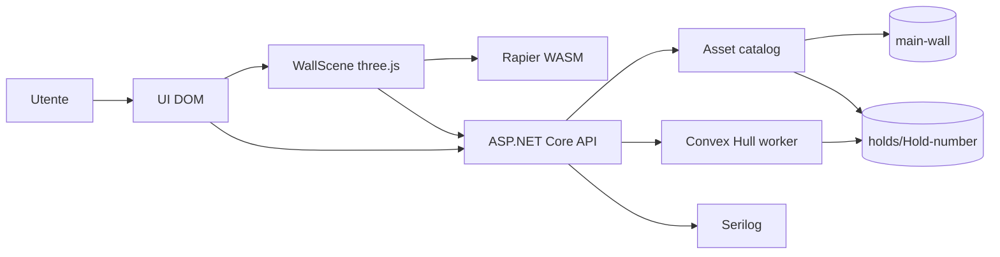
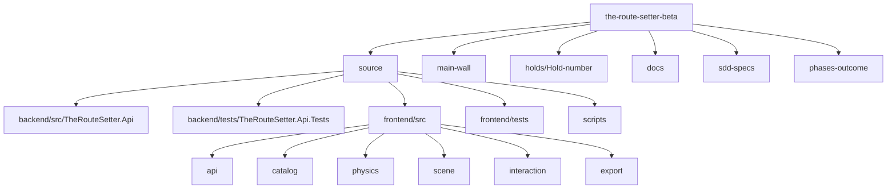
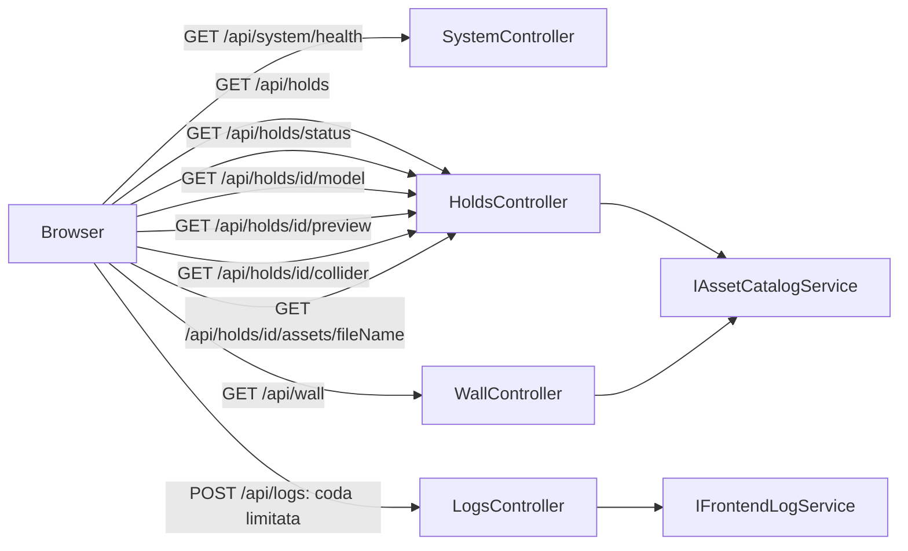
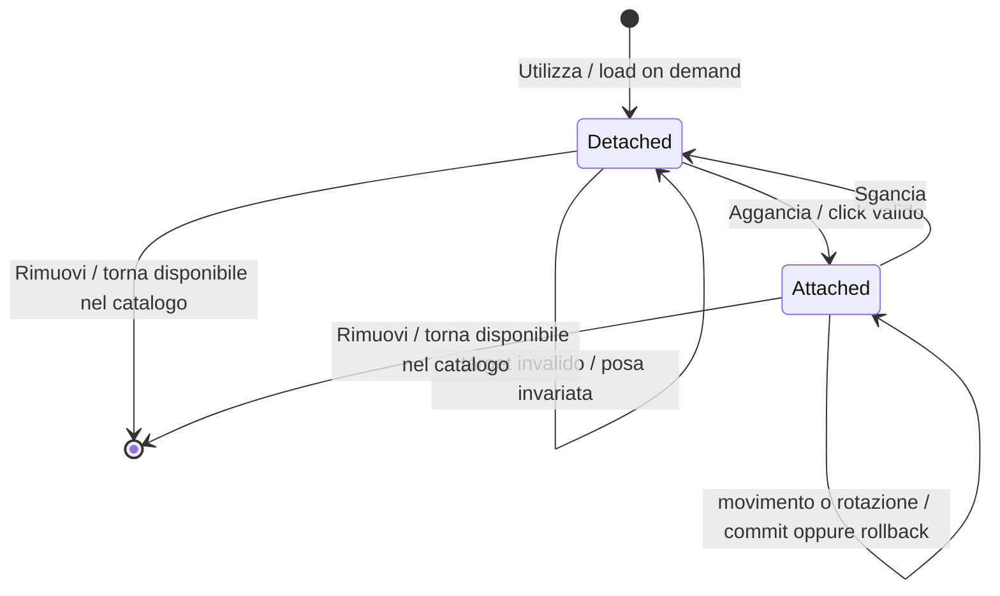
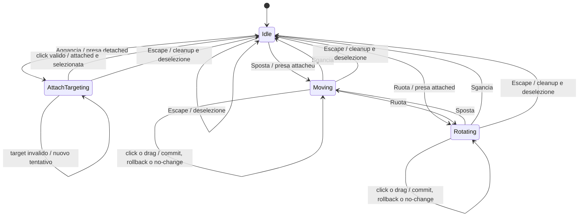
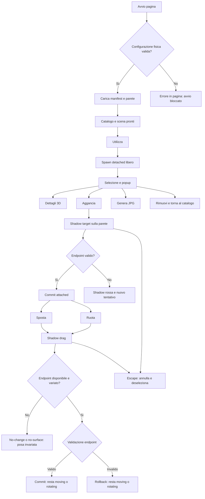
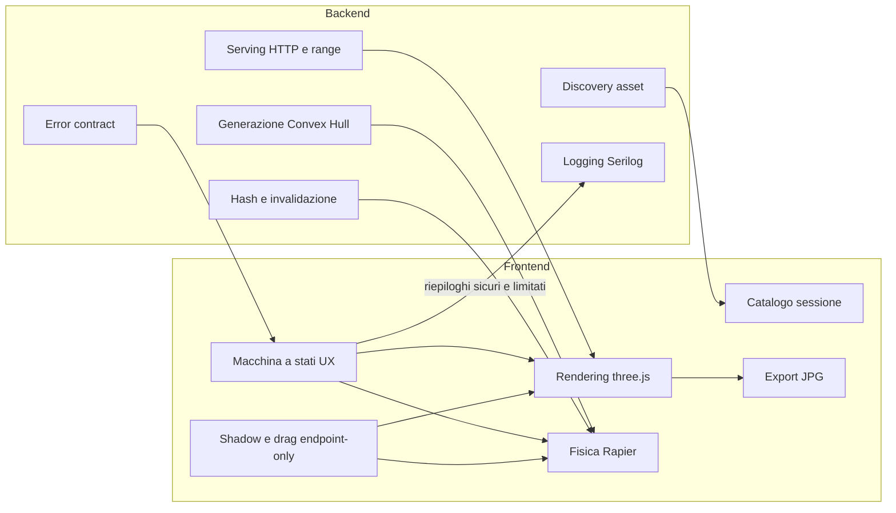
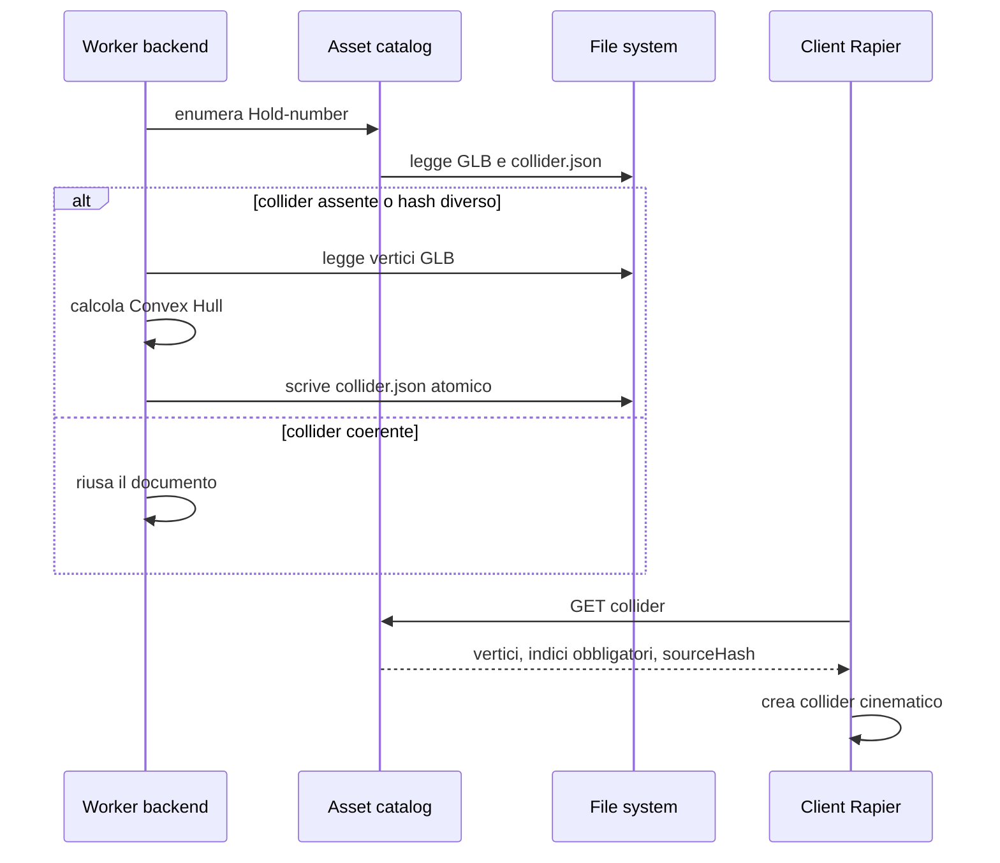
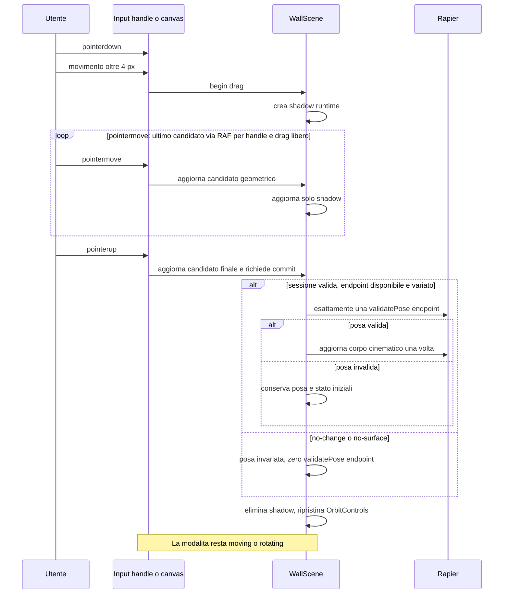

# Guida Applicativa E Tecnica

**TheRouteSetter v0.0.1: release CHIUSA per accettazione dell'utente, con limiti noti accettati.** Stato, evidenze e punti di attenzione sono raccolti nel solo [stato della versione](../sdd-specs/06-stato-versione-v0.0.1.md), non in questa guida operativa. La chiusura non equivale a certificazione universale.

Il target ufficiale e solo Google Chrome Stable desktop con WebGL 2.0; la versione verificata e `152.0.7977.76`. Gli aggiornamenti Chrome successivi richiedono le normali verifiche di regressione. Chromium e Firefox pinned restano runtime di test, Edge e Firefox non sono browser supportati della baseline v0.0.1; gli strumenti opzionali restano disponibili.

## Scopo

TheRouteSetter consente di comporre una tracciatura di arrampicata su una parete tridimensionale. Il browser visualizza la parete e il catalogo locale, crea le istanze delle prese, gestisce la fisica Rapier, il targeting, le trasformazioni e l'esportazione JPG. Il backend ASP.NET Core scopre e distribuisce gli asset, genera i collider Convex Hull mancanti e gestisce logging server ed errori applicativi. Il frontend inoltra al server riepiloghi diagnostici sicuri tramite un reporter globale e applicativo con coda volatile limitata, senza logging di rete per frame.

Non esistono account, autenticazione o persistenza delle tracciature. Lo stato della composizione vive esclusivamente nella sessione browser.

## Baseline E UX Attiva

Le fasi 0-9 costituiscono la baseline storica. Alcuni nomi tecnici e test conservano termini come `snap`, ma non descrivono più un aggancio automatico attivo.

Dalla fase 9UX la UX normativa è:

- selezione della presa con popup contestuale;
- `Dettagli`, `Aggancia`, `Sgancia`, `Ruota`, `Sposta` e `Rimuovi` nel popup;
- aggancio esplicito tramite mouse e shadow 3D aderente alla parete;
- movimento e rotazione con click incrementale oppure drag transazionale;
- preview shadow durante il drag e commit soltanto al rilascio;
- nessun comando legacy avanti/indietro e nessuna shortcut globale di trasformazione;
- `Escape` annulla la modalità, elimina la preview, deseleziona la presa e nasconde il popup.

Il primo gruppo (`DEC-025`) riguarda tolleranza/diedri, continuita dei click, diagnostica locale e regressioni. `DEC-026`, approvata dall'utente, ne sostituisce soltanto la parte tolleranza con soglie separate e configurazione runtime della parete. Il consolidamento successivo implementa backend/catalogo, gestione errori e lifecycle. `DEC-028` approva i click arrestati al prefisso conservativo nella direzione richiesta, senza sliding automatico, e gli indici collider obbligatori; non modifica il drag endpoint-only.

## Architettura



Il backend non esegue la simulazione fisica. Il frontend mantiene separate la mesh grafica Three.js e il collider Rapier. La parete usa un TriMesh statico; ogni presa usa un rigid body cinematico con Convex Hull pre-calcolato.

## Struttura Dei Sorgenti



Gli asset sono esterni a `source`. Le cartelle delle prese devono rispettare `Hold<number>`. I sorgenti applicativi e di test sono contenuti in `source`; la documentazione stabile è in `docs`.

## API



| Metodo | Percorso | Scopo |
|---|---|---|
| `GET` | `/api/system/health` | Disponibilità del backend. |
| `GET` | `/api/wall` | Modello GLB della parete con supporto range. |
| `GET` | `/api/holds` | Manifest leggero delle prese, senza contenuto GLB. |
| `GET` | `/api/holds/status` | Readiness `no-store`: solo `id`, `colliderStatus`, `colliderUrl`. |
| `GET` | `/api/holds/{id}/model` | Modello GLB caricato on demand. |
| `GET` | `/api/holds/{id}/preview` | Immagine catalogo opzionale. |
| `GET` | `/api/holds/{id}/collider` | Documento JSON del Convex Hull pronto. |
| `GET` | `/api/holds/{id}/assets/{fileName}` | Asset opzionale appartenente alla presa. |
| `POST` | `/api/logs` | Eventi sanitizzati dal reporter frontend; ricevuta HTTP 202 correlata, accettazione best effort. |

Swagger UI e esposta su `/swagger`; il documento OpenAPI e `/swagger/v1/swagger.json`. Nella pipeline applicativa, eccezioni, binding/validazione MVC, risorse/route mancanti e status di errore condividono `ErrorResponse` con `errorId`, `requestId` e messaggio non tecnico. HTTP 416 conserva `Content-Range` e restituisce lo stesso JSON sicuro; i range validi restano HTTP 206. Risposte gia iniziate e rifiuti del trasporto/proxy precedenti alla pipeline non possono essere riscritti con questo contratto. Limiti dei payload, correlazione e schema sono nei [contratti backend](backend-contracts.md).

## Lifecycle Della Presa

Stato fisico dell'istanza, distinto dalla presenza nel catalogo e dalla modalita UI:



Modalita UI della presa selezionata:



Lo stato fisico e `detached` o `attached`; la modalita UI e `idle`, `attach-targeting`, `moving` o `rotating`. `idle` non implica deselezione: il commit di aggancio conserva selezione e popup, sopprimendo la successiva selezione involontaria del click DOM; `Escape` deseleziona senza sganciare. Dopo un commit o rollback di trasformazione si resta in `moving` o `rotating`.

Il lifecycle mantiene una sola presa e una sola sessione drag attive, con cleanup senza commit su `pointercancel`, perdita della capture, blur, rimozione e cambio selezione. CON04 aggiunge regressioni deterministiche per le sequenze asincrone e gli eventi; la verifica finale cross-browser resta distinta dalla presenza di questi percorsi.

| Percorso | Stato e limite dell'evidenza |
|---|---|
| `pointerup` con sessione attiva | Conclude la transazione, elimina shadow e ripristina l'abilitazione precedente di OrbitControls; non termina la modalita di trasformazione. |
| `pointercancel` / `lostpointercapture` | Annulla handle e drag libero; il rilascio della capture dopo commit non annulla una nuova sessione. |
| Blur / cambio selezione / rimozione / `Escape` | Annulla preview, frame e stato pointer; rilascia capture e ripristina controlli. |
| Dettagli con caricamenti sovrapposti | Generazione della richiesta e cleanup idempotente scartano successi/errori obsoleti. |
| Errore irreversibile del rendering/callback scena | Arresta i frame, annulla interazioni, disabilita controlli e rifiuta comandi successivi senza mutazioni invisibili. |

## Flusso UI



### Catalogo E Dettagli

Il manifest viene caricato una volta per sessione. Le preview sono richieste subito alla creazione delle card (`eager`), anche fuori viewport, e memorizzate nella cache di sessione; non sono lazy su visibilita o click. Un guasto di caricamento preview viene segnalato al reporter e mantiene il fallback della card. GLB e collider sono invece caricati on demand: il GLB quando si aprono i dettagli o si usa una presa, il collider quando la si inserisce in scena. I modelli con lo stesso URL condividono download, parsing, geometrie e texture tramite reference counting finche esistono riferimenti attivi.

Solo finche esistono prese `Pending`/`Missing`, il catalogo richiede `/api/holds/status` serialmente: intervallo iniziale `1 s`, timeout `10 s`, backoff degli errori fino a `30 s`. Aggiorna readiness e pulsante `Utilizza` senza reload, refetch del manifest/preview o caricamento anticipato dei GLB; `Ready` e `Failed` sono terminali per il watcher. Il dispose interrompe richiesta e timer. La discovery backend isola cartelle problematiche e suffissi numerici fuori range; dopo la discovery iniziale un ID mai accodato e `Failed`, non un Pending senza fine. Non e un hot reload degli asset.

Il viewer `Dettagli` e condiviso tra catalogo e popup. Una generazione identifica l'apertura corrente: chiusura/riapertura o aperture sovrapposte non accettano risultati obsoleti. Il cleanup viene predisposto prima dei caricamenti e rilascia observer, controlli, renderer, canvas, istanza e riferimento al modello anche dopo errori intermedi. Un caricamento completato dopo la chiusura rilascia la propria risorsa senza sostituire il viewer corrente.

### Targeting E Aggancio

La shadow gialla segue il ray centrale e orienta l'asse locale `+Z` sulla normale della parete, conservando il twist. Il footprint della base non è disegnato, ma genera 37 campioni deterministici. Al click gli hit sono raggruppati per continuità e compatibilità delle normali; il gruppo dominante determina punto e normale. Una posa invalida non modifica la presa e rende temporaneamente rossa la shadow.

Camera change e resize ricalcolano il target dall'ultima posizione del puntatore anche a mouse fermo. Durante targeting il sinistro e riservato all'aggancio; la camera mantiene i gesti consentiti senza avviare una trasformazione della presa. Durante drag la camera e congelata e il resize e rinviato, poi applicato alla chiusura della sessione. Popup e frecce usano i bounds proiettati della presa, non offset fissi indipendenti dalla geometria.

### Movimento E Rotazione

Il click sulle frecce richiede `1 cm` o `1°`, arrestando il passo alla frazione ammessa dalle query. Solo i click di movimento restano entro `5°` dalla normale di aggancio e si arrestano su gap o discontinuita. Oltre la soglia pointer di `4 px`, il gesto diventa una transazione: la presa reale e il collider restano invariati, la shadow mostra il candidato e il rilascio valida solo l'endpoint, senza query collisioni durante pointermove. Il drag da freccia e vincolato all'asse; quello iniziato sulla presa usa entrambe le dimensioni dello schermo, con contact point sotto al puntatore senza offset iniziale. Il drag usa la prima superficie visibile dell'intero modello, puo cambiare pannello senza limite di `5°` e trasporta l'orientamento sulla nuova normale. Un endpoint invalido annulla tutto; senza hit la shadow e nascosta e l'endpoint non e committabile, fino a un nuovo hit.

Gli aggiornamenti da frecce/handle e drag libero sulla presa sono raggruppati tramite RAF; al rilascio viene applicata l'ultima posizione del puntatore prima del commit. Al rilascio di una sessione valida si esegue esattamente una `validatePose` solo con endpoint disponibile e variato; `no-change` e `no-surface` terminano senza validazione fisica endpoint. I raycast geometrici per trovare la superficie non sono inclusi in questo conteggio. La verifica esaustiva delle query native resta un criterio di accettazione distinto dal contatore applicativo.

### Validazione Fisica E Limiti

`PhysicsWorld` misura la posa originale con `collider.contactShape` contro l'intero TriMesh e le altre prese, senza spostarla verso l'esterno lungo la normale del pannello. La broadphase AABB nativa seleziona i candidati con semiestensione `raggio + prediction`; i contatti negativi devono essere confermati da `intersectsShape`, mentre risposte contraddittorie oltre epsilon rendono la posa incerta e non committabile. Il contatto e valido; la tolleranza parete e configurabile in `1..10 mm`, decimali inclusi, default `5 mm`, mentre fra prese resta immutabile a `1 mm`. L'epsilon numerico separato resta `2e-6 m`. Per endpoint e intervalli governa il minimo per contatto di `distance + tolerance`, non la distanza grezza piu profonda con una soglia unica: ad esempio una parete a `-4 mm` entro i suoi `5 mm` non puo mascherare una presa a `-2 mm` oltre il suo `1 mm`. Le sole query fra coppie convesse supportate usano copie normalizzate di fattore `100`, con gli stessi vertici e indici degli hull precalcolati e distanze riconvertite in metri. Non vengono generati hull frontend: GLB, geometria renderizzata e collider del mondo restano invariati.

Per i click, lo shape cast opera solo a rotazione fissa e da partenza separata, arrestando la traslazione prima del primo contatto, anche verso il pavimento: la tolleranza non autorizza lo sweep a proseguire fino alla profondita ammessa. Contatti iniziali e rotazione sono gestiti dalla suddivisione ricorsiva degli intervalli, confrontando il margine minimo `distance + tolerance` con il massimo moto dei punti del collider, dato da traslazione piu raggio per angolo di rotazione. Ogni chiamata usa budget `512` e bound minimo `2e-6 m`; gli intervalli incerti o irrisolti sono bloccati conservativamente, non accettati perche gli endpoint sono liberi. La regressione pavimento/pinna nello stesso collider con contatto iniziale passa, ma non elimina il limite nativo dei cast da contatto iniziale. Il drag resta editoriale endpoint-only e non usa questo controllo del percorso. Il surface-lock dei click resta a `5 gradi` e il gap massimo di riproiezione a `5 mm`, indipendenti dalla tolleranza parete.

Limiti noti Rapier `0.12.0` accettati per v0.0.1, riproduzioni CON09 e valutazioni future sono centralizzati nello [stato della versione](../sdd-specs/06-stato-versione-v0.0.1.md). Questa sezione descrive l'algoritmo implementato, non garanzie fisiche universali.

La tolleranza configurabile (`DEC-026`) non garantisce che ogni superficie sia agganciabile ne compensa necessariamente tutte le imperfezioni di modelli da foto/fotogrammetria. Una soglia maggiore ammette maggiore penetrazione parete, non corregge la mesh o la precisione delle query.

Se una query rileva una violazione accertata e un altro collider restituisce dati incerti, prevale la violazione: la posa resta rifiutata per collisione, non per semplice incertezza. Blocker, handle, penetrazione, tolleranza e `uncertain: false` restano riferiti allo stesso contatto. Senza violazioni confermate, l'incertezza resta bloccante e produce `path-unresolved`.

### Export

`Genera immagine` produce un JPG con lato lungo `2560 px`, rapporto della viewport e qualità `0.90`. Il render temporaneo clona camera e proiezione esatte, senza ricalcolare l'aspect dai pixel arrotondati, conserva lo sfondo, esclude DOM, evidenziazioni, shadow e indicatori e ripristina lo stato nel `finally`, anche su errore render/JPEG. Il comando e disabilitato durante un drag.

## Responsabilità Backend E Frontend



## Flusso Convex Hull



## Flusso Drag Transazionale



La sequenza descrive una sessione attiva conclusa normalmente, non un click incrementale ne la matrice completa delle cancellazioni. Nessuna `validatePose`, `contactShape` o shape-cast durante pointermove; restano i raycast geometrici. Una richiesta senza sessione valida e `not-available` e non esegue la validazione endpoint.

## Configurazione

Il backend legge `source/backend/src/TheRouteSetter.Api/appsettings.json`:

- `AssetStorage.RootPath`: radice che contiene `main-wall` e `holds`;
- `AssetStorage.MainWallDirectory`: directory della parete;
- `AssetStorage.HoldsDirectory`: directory delle prese;
- `Logging.FilePath`: pattern file Serilog;
- `Logging.RetentionDays`: retention, valore predefinito 7;
- `Logging.QueueCapacity`: capacità della coda asincrona.

Le variabili d'ambiente ASP.NET Core possono sovrascrivere i valori con la sintassi `Sezione__Chiave`, per esempio `AssetStorage__RootPath`.

Il frontend usa:

- `E2E_FRONTEND_PORT`, `E2E_BACKEND_PORT`, `E2E_BACKEND_COMMAND`, `E2E_REUSE_SERVER` per la suite E2E;
- `E2E_BROWSERS`: matrice opzionale separata da virgole, default `chromium`; valori `chromium,chrome,msedge,firefox`, senza skip silenzioso se il browser richiesto manca;
- `PERF_FRONTEND_PORT`, `PERF_BACKEND_PORT`, `PERF_BACKEND_COMMAND`, `PERF_BROWSER`, `PERF_HEADLESS`, `PERF_DURATION_MS`, `PERF_HOLD_COUNT` e `PERF_SMOKE` per il benchmark. Lo smoke ridotto non certifica il profilo hardware; comandi e metodo split-phase in [test automatici](test-automatici.md).

### Tolleranza Parete Runtime

Il file sorgente da modificare e `source/frontend/public/physics-config.json`. Contenuto iniziale:

```json
{
  "wallPenetrationToleranceMm": 5
}
```

Il valore e un numero JSON in millimetri da `1` a `10` inclusi. Sono ammessi decimali, ad esempio `7.5`, con punto e senza virgolette: non `"5"` o `7,5`. Nessun commento, virgola finale o chiave aggiuntiva. La tolleranza fra prese e sempre `1 mm` e non ha una chiave modificabile; l'epsilon resta `2e-6 m`.

Il frontend richiede il file una sola volta al bootstrap con `cache: 'no-store'`, prima di creare la scena. Non lo importa nel bundle e non lo rilegge durante le interazioni. La configurazione resta fissa per quella sessione; solo una nuova apertura/reload applica il valore cambiato. File mancante, errore HTTP/rete, JSON malformato o valore invalido impediscono l'avvio senza ripiegare silenziosamente su `5 mm`: compare un errore gestito nella pagina, non un'eccezione `pageerror` non gestita. Correggere il file servito e ricaricare.

**Prima di modificare il file, esportare l'eventuale vista da conservare con `Genera immagine`.** Il reload perde tutte le prese e lo stato della sessione. Il JPG salva soltanto un riferimento visivo: non e una sessione editabile e non permette di ripristinare la tracciatura. Vite puo ricaricare automaticamente la pagina non appena si modifica un file in `public`, quindi non attendere il reload manuale per esportare.

In sviluppo, con `npm run dev` gia avviato:

1. Esportare prima dell'edit se serve un riferimento della sessione corrente.
2. Modificare il numero in `source/frontend/public/physics-config.json` e verificare il JSON.
3. Ricaricare la pagina se Vite non l'ha gia ricaricata; controllare il valore attivo in console come indicato in Avvio Debug.

Non occorrono riavvio del backend, riavvio del frontend, compilazione o nuova installazione delle dipendenze per questo cambio di valore: Vite serve direttamente `public`.

In produzione, il codice che introduce questa funzionalita richiede prima la normale installazione delle dipendenze (`npm ci`), build (`npm run build`) e distribuzione iniziali. Dopo tale deploy:

1. Individuare il `dist/physics-config.json` effettivamente distribuito e servito dal sito (alla base URL dell'applicazione).
2. Dopo l'eventuale export, modificarne il numero e ricaricare la pagina. Con un server statico non servono rebuild o riavvio del server/backend.
3. Riportare il valore permanente in `source/frontend/public/physics-config.json`: il build successivo copia `public` e sovrascrive il file in `dist`.

Modificare soltanto `source/frontend/public/physics-config.json` non cambia un deploy esistente: occorre ricompilare/distribuire oppure copiare quel JSON nella posizione servita. Configurare server statico, reverse proxy e CDN/cache affinche rispettino `Cache-Control: no-store` per `physics-config.json`; il `no-store` della fetch browser non sostituisce la configurazione degli intermediari. In DevTools Network verificare che la risposta contenga il nuovo valore.

Evidenza prodotta durante l'implementazione `DEC-026`: su una build di produzione in dist temporanea, il file reale servito e stato modificato `5 -> 3 -> 5` e ciascun valore e stato applicato al reload senza rebuild fra le modifiche. Non e soltanto una risposta simulata nei test e non e una verifica del deployment operativo. Anche gli esiti unitari `331/331` in `12` file ed E2E `43/43` sono evidenze dell'implementazione, non test prodotti o eseguiti dall'utente. La conferma dell'utente riguarda la risoluzione del bug funzionale originale. Provenienza corrente nel report di stato; il [report storico DEC-026](../phases-outcome/Wall_tolerance_configuration_done.md) resta invariato.

### Prove Consigliate

| Valore parete | Uso suggerito |
|---|---|
| `1 mm` | Baseline piu restrittiva, confrontabile con la precedente soglia unica. |
| `3 mm` | Prova conservativa. |
| `5 mm` | Default raccomandato sulla base delle pose reali verificate. |
| `7.5 mm`, `10 mm` | Prove esplorative; non una garanzia di risoluzione su tutte le superfici. |

Confrontare gli stessi punti, click `+/-1 cm` e twist `+/-1 grado`, annotando il valore attivo e il motivo del rifiuto. Ogni reload azzera la sessione: esportare prima di ciascun edit. I risultati reali verificati sono in `docs/test-automatici.md`; non modificare soglia hold, limite angolare o gap per queste prove.

## Avvio Live

Questa sezione descrive lo sviluppo locale con Vite e `dotnet run`, non un deployment di produzione. Per pubblicare l'applicazione usare la sezione Produzione seguente.

Prerequisiti: .NET SDK `8.0.424`, Node.js `22.18.0`, npm `10.9.3` e Google Chrome Stable desktop con WebGL 2.0.

Backend, dalla cartella `source`:

```powershell
dotnet restore .\TheRouteSetter.sln --locked-mode
dotnet run --project .\backend\src\TheRouteSetter.Api\TheRouteSetter.Api.csproj --launch-profile http
```

Frontend, dalla cartella `source/frontend`:

```powershell
npm ci
npm run dev -- --host 127.0.0.1
```

Aprire `http://127.0.0.1:5173`. Il proxy Vite inoltra `/api` a `http://127.0.0.1:5080`.

## Produzione

Procedura minima di riferimento, non eseguita ne certificata in questo aggiornamento. Sostituire percorsi e dominio con quelli dell'ambiente; i controlli HTTP sotto sono verifiche da eseguire, non esiti di un deploy gia testato. La build frontend e statica: ne Vite dev/preview ne `dotnet run` sono il servizio di produzione.

Pubblicare il backend dalla cartella `source`:

```powershell
dotnet restore .\TheRouteSetter.sln --locked-mode
dotnet publish .\backend\src\TheRouteSetter.Api\TheRouteSetter.Api.csproj -c Release --no-restore -o .\publish\api
```

Preparare il frontend dalla cartella `source/frontend`:

```powershell
npm ci
npm run build
```

Distribuire il contenuto di `source/publish/api` nella directory API e quello di `source/frontend/dist` nella directory del sito statico, incluso `physics-config.json`. Il publish indicato richiede il runtime ASP.NET Core 8 sul server. Distribuire separatamente `main-wall` e `holds`: non assumere che il publish includa gli asset esterni.

Esempio Windows, dalla directory API pubblicata, con directory asset e log gia predisposte:

```powershell
$env:ASPNETCORE_ENVIRONMENT = 'Production'
$env:AssetStorage__RootPath = 'D:\RouteSetter\assets'
$env:Logging__FilePath = 'D:\RouteSetter\logs\log-.json'
dotnet .\TheRouteSetter.Api.dll --urls http://127.0.0.1:5080
```

`AssetStorage__RootPath` deve essere assoluto e contenere `main-wall` e `holds`. L'identita del servizio deve poter leggere gli asset e creare/sostituire i `collider.json` nelle cartelle delle prese, oltre a scrivere e rimuovere i file nella directory log per la retention. Non riusare il `RootPath` relativo di sviluppo. Configurare directory di lavoro, variabili e avvio/riavvio nel gestore di servizi della piattaforma; il comando sopra da solo non installa un servizio.

Servire `dist` con un server statico e inoltrare `/api/` alla API sulla stessa origine, mantenendo il prefisso. Esempio minimo Nginx, con percorsi da adattare:

```nginx
server {
    listen 80;
    server_name routes.example.test;
    root D:/RouteSetter/site;
    index index.html;

    location = /physics-config.json {
        add_header Cache-Control "no-store" always;
        try_files $uri =404;
    }
    location /api/ {
        proxy_pass http://127.0.0.1:5080;
    }
    location / {
        try_files $uri $uri/ /index.html;
    }
}
```

L'esempio non configura TLS: predisporre HTTPS e le regole di rete prima dell'esposizione pubblica. Nessuna autenticazione e aggiunta dall'applicazione; valutare le restrizioni di accesso al proxy. `/swagger` non e inoltrato dall'esempio: verificarlo sull'origine backend oppure pubblicarlo esplicitamente secondo la policy dell'ambiente. Controllare sul sito distribuito pagina iniziale, `/api/system/health`, `/api/holds`, `/api/wall` e `physics-config.json`; verificare download GLB/collider, supporto range e scrittura log con l'identita effettiva del servizio. L'API non serve automaticamente il frontend statico e il proxy Vite non esiste in produzione.

## Avvio Debug

Backend con hot reload, dalla cartella `source`:

```powershell
dotnet watch --project .\backend\src\TheRouteSetter.Api\TheRouteSetter.Api.csproj run --launch-profile http
```

Frontend con HMR e source map, dalla cartella `source/frontend`:

```powershell
npm run dev -- --host 127.0.0.1
```

Usare DevTools del browser per TypeScript/WebGL e il debugger .NET dell'IDE collegato al processo API. Lo snapshot `window.__ROUTE_SETTER_SCENE__` è diagnostico per gli E2E; la telemetria `window.__ROUTE_SETTER_PERFORMANCE__` esiste solo con query string `?performance=1`.

Per diagnosticare un rifiuto, consultare in sola lettura lo snapshot corrente in DevTools, senza modificarlo:

```javascript
window.__ROUTE_SETTER_SCENE__?.collisionTolerancesMm
window.__ROUTE_SETTER_SCENE__?.lastActionResult?.reason
window.__ROUTE_SETTER_SCENE__?.lastPoseDiagnostic
```

Con il file iniziale, `window.__ROUTE_SETTER_SCENE__.collisionTolerancesMm` restituisce `{ wall: 5, holds: 1 }`. Sono valori attivi in millimetri da leggere, non da assegnare per cambiare la fisica. `lastPoseDiagnostic.toleranceMeters` e invece in metri e indica la soglia scelta per il contatto governante dal minimo `distance + tolerance`, non necessariamente il contatto con distanza grezza piu profonda; anche `penetrationMeters` va interpretato rispetto a quel contatto, non come massimo globale indipendente.

`reason` distingue `wall-collision`, `hold-collision`, `no-surface`, `surface-gap`, `normal-limit`, `no-change` e `path-unresolved`; puo essere assente quando non applicabile. `path-unresolved` significa arresto conservativo, non collisione accertata. `lastPoseDiagnostic` contiene `position`, `rotation` (quaternion), `blocker`, `penetrationMeters`, `toleranceMeters`, `colliderHandle` e il booleano `uncertain` dell'ultima `validatePose`. Puo essere nullo o precedente all'azione corrente (ad esempio no-op o controllo del percorso senza query endpoint); non rappresenta una cronologia ne una misura certificata nei casi limite descritti sopra. Una violazione accertata prevale su risposte contraddittorie di altri collider: tutti i campi restano associati al contatto della violazione e `uncertain = false`. Senza violazioni accertate, viene selezionato un contatto incerto con campi coerenti e `uncertain = true`, senza sentinelle infinite in `penetrationMeters`: la UI restituisce `path-unresolved` anche in presenza di un blocker. Sono dati volatili in memoria, senza log persistenti, invii di rete o logging per frame.

## Errori E Logging

Il middleware di correlazione assegna un identificatore alla richiesta; la pipeline produce il contratto sicuro della sezione API quando puo ancora scrivere la risposta. Serilog scrive JSON tramite consumer asincrono con coda limitata, livelli .NET `Trace..None` e override per prefisso di categoria. Il logger di completamento HTTP usa l'istanza dell'host tramite DI. La retention usa l'eta `LastWriteTimeUtc` e il pattern configurato, all'avvio e al cambio giorno anche senza eventi tramite timer idle, non il semplice numero di file.

`AppError` e gli helper HTTP separano messaggio pubblico, categoria e identificativi validati dai dettagli tecnici. `main.ts` collega i catch applicativi e gli eventi globali `error`/`unhandledrejection` a `ErrorReporter`; gli handler globali non sopprimono la diagnostica nativa del browser. Il reporter conserva al massimo `20` eventi e `100` chiavi di deduplica per `30 s`, con un invio alla volta, throttle `1 s`, timeout `5 s` e massimo `3` tentativi; il proprio trasporto non genera segnalazioni ricorsive. Nessun log persistente nel browser, payload grezzo o rete per frame. Anche i guasti preview caricata dal catalogo vengono segnalati; `lastActionResult.reason` e `lastPoseDiagnostic` restano invece diagnostica locale volatile.

L'avvio fallisce in modo chiuso se configurazione, parete o inizializzazione non sono recuperabili. Dopo un guasto irreversibile di rendering/callback, la scena ferma i frame e rifiuta ulteriori comandi, aggiunte ed export: non prosegue a modificare una composizione non piu visibile. Gli errori locali recuperabili mantengono rollback e operazioni indipendenti. Questo comportamento non promette recupero universale da ogni eccezione. La sanitizzazione e ricorsiva e il contesto browser usa una allowlist; dati personali arbitrari non etichettati non sono riconoscibili con garanzia assoluta: inviare solo riepiloghi diagnostici.

## Risoluzione Problemi

- `Parete non disponibile`: verificare `AssetStorage.RootPath`, la cartella `main-wall` e `GET /api/wall`.
- Configurazione fisica non valida/non disponibile: controllare la risposta di `physics-config.json`, numero `1..10` senza virgolette, punto decimale, nessun commento o altra chiave. Correggere il file effettivamente servito, controllare cache/proxy e ricaricare; nessun fallback automatico. Questo caso non richiede una correzione generale del backend.
- Presa senza pulsante `Utilizza`: verificare `colliderStatus` nel manifest e la presenza di `collider.json`.
- Errori proxy frontend: verificare che il backend ascolti sulla porta `5080` o impostare `E2E_BACKEND_PORT` coerentemente.
- WebGL non disponibile: aggiornare driver/browser e verificare l'accelerazione hardware.
- Benchmark a pochi FPS in headless: eseguire headed; SwiftShader e il throttling RAF non certificano il profilo hardware.
- Porta occupata: terminare il processo esistente o impostare le variabili porta supportate dalle configurazioni Playwright/Vite.
